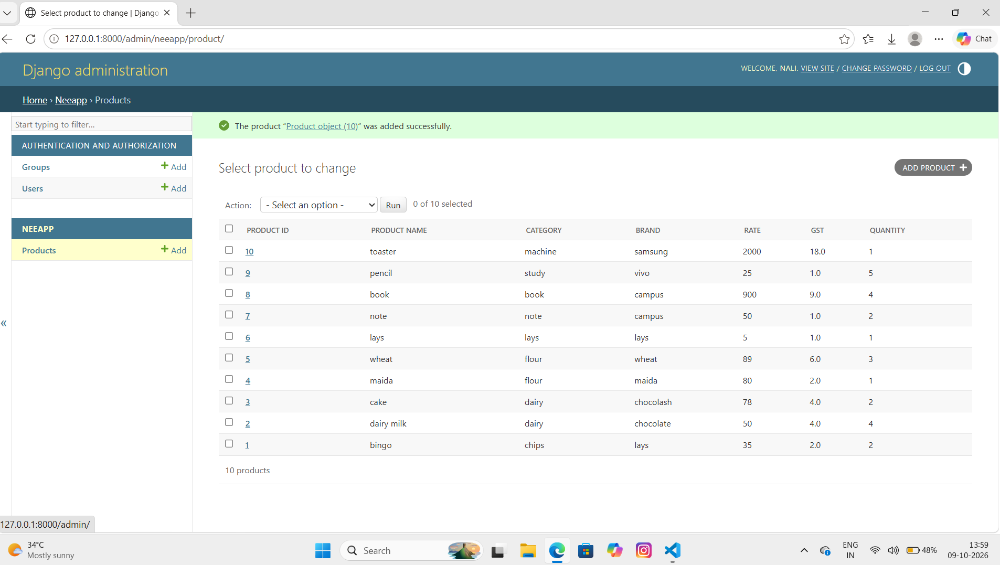

# Ex02 Django ORM Web Application
## Date: 09.10.2026

## AIM
To develop a Django Application to store and retrieve data from a Vehicle Service Database platform using Object Relational Mapping(ORM).

## ENTITY RELATIONSHIP DIAGRAM


## DESIGN STEPS

### STEP 1:
Clone the problem from GitHub

### STEP 2:
Create a new app in Django project

### STEP 3:
Enter the code for admin.py and models.py

### STEP 4:
Detect changes and create migration files that describe how to modify the database schema

### STEP 5:
Execute the migration files and update the database schema to match your Django models

### STEP 6:
Create a superuser with full access rights to all models and data through the admin interface.

### STEP 7:
Apply the migration files of the created app to the database

### STEP 8:
Execute Django admin using localhost and create details for 10 entries

## PROGRAM
```
models.py
from django.db import models
from django.contrib import admin
class Product(models.Model):
    Product_Id=models.IntegerField(primary_key=True)
    Product_Name=models.CharField(max_length=10)
    Category=models.CharField(max_length=20)
    Brand=models.CharField(max_length=10)
    Rate=models.IntegerField()
    Gst=models.FloatField()
    Quantity=models.IntegerField()
class ProductAdmin(admin.ModelAdmin):
    list_display = [
        "Product_Id",
        "Product_Name",
        "Category",
        "Brand",
        "Rate",
        "Gst",
        "Quantity"
         ]

admin.py
from django.contrib import admin
from .models import Product,ProductAdmin
admin.site.register(Product,ProductAdmin)


```


## OUTPUT



## RESULT
Thus the program for creating Online Food Delivery Database using ORM hass been executed successfully
